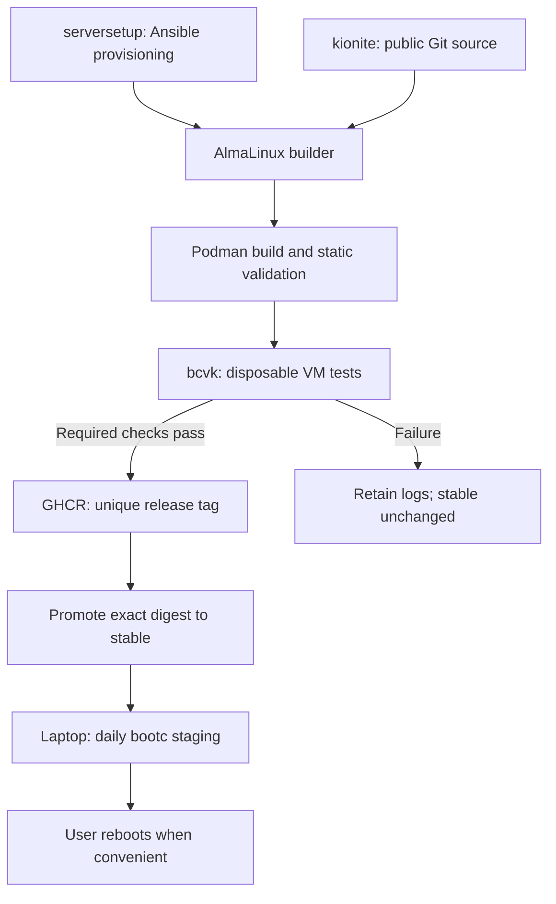

# Plan: Automated Kionite builds on the homelab

## Selected architecture

Ansible -> dedicated AlmaLinux 10 VM -> Podman -> bcvk tests -> GHCR -> bootc upgrade.

This replaces the earlier proposal for a GitHub Actions runner, dedicated local
registry, and signing in version one. Use systemd scheduling on one builder and
public GHCR distribution. Signing and additional release verification can follow.
This document plans the work; it does not provision VMs or enable automatic updates.



## Existing baseline

- Image repository: https://github.com/HakonSkogsrud/kionite, public HTTPS checkout.
- Current source: `0044a2f0928067a73326bb85b1c1d849793acc6c`.
- Prototype builder: VM 103, `10.0.0.139`, AlmaLinux 10.2, 4 GiB RAM,
  temporary 4 GiB swap, 100 GiB root disk.
- Test desktop: `10.0.0.59`; existing custom Kinoite deployment remains unchanged.
- Built extension image: `10.0.0.139:5000/my-kinoite:44-desktop-extensions`,
  digest `sha256:4dbb28abd2d7446c3c6fdefbf51e952bfb42d46c083cbb0dcb7deb26902c40a2`.
- Klassy and Smooth Swipe compile against the image's KDE/Qt packages; their
  runtime libraries resolve. Bootc lint passed 14 checks, 1 skipped.
- The extension revision has not been boot-tested on the desktop. Earlier prototype
  update/rollback tests changed metadata rather than actual packages or files.
- Nix uses persistent `/var/nix` bind-mounted onto `/nix`. Home Manager supplies
  packages/session integration; personal dotfiles belong in `.dotfiles` with Stow.
- RPM Firefox is removed; Fedora and full Flathub are configured. All Flatpak apps
  are installed manually.

## Repository ownership

Follow this repository's existing layout, which has `roles/` and `playbooks/`
at the repository root, rather than introducing an `ansible/` prefix.

| Repository | Responsibility |
|---|---|
| serversetup | VM provisioning, builder packages, dedicated user, storage, secrets deployment, systemd service/timer, monitoring |
| kionite | Containerfile, extension builds, Nix integration, pipeline, tests, publication, release records and recovery instructions |
| .dotfiles | Personal configuration linked through Stow; independently updated |

Proposed serversetup additions: `roles/kionite_builder/`, a dedicated provisioning
playbook, inventory/defaults, and eventually desktop onboarding/update staging.
Reuse `create_vm` and bootstrap roles after inspecting their recreation/disk-growth
behavior. Do not put the builder in a blanket `force_recreate=true` deployment.

Proposed kionite additions:

```text
scripts/pipeline.sh
scripts/test-vm.sh
scripts/publish.sh
tests/static.sh
tests/smoke.sh
tests/desktop.sh
```

`pipeline.sh` is the single entry point for manual and scheduled builds. Extend the
existing build script and host verification instead of duplicating image logic.

## Builder provisioning

Starting allocation: 4-8 vCPU, 12-16 GiB RAM, 120-150 GiB disk. Decide whether to
adopt VM 103 or create a replacement before applying infrastructure changes.

Ansible configures:

- Podman, Skopeo, Git, bcvk, QEMU/KVM, qemu-img, virtiofsd, and the dependencies
  required by the installed bcvk package. Buildah is optional for this pipeline.
- EPEL 10 for bcvk; upstream documents EPEL 9/10 packaging. Verify actual package
  availability and versions on this builder during the first implementation step.
- A dedicated build account, writable build/cache/test directories and persistent
  configuration. Do not copy infrastructure SSH keys, Proxmox credentials, or the
  Ansible Vault password to it.
- Rootless Podman initially, with subuid/subgid mappings, KVM access and any session
  configuration required by unattended operation. Check the existing privileged
  Containerfile build works rootlessly before adopting this execution model.
- The builder's VM CPU exposes virtualization extensions. Verify nested KVM on
  Proxmox and usable `/dev/kvm` inside the guest before VM tests.
- bcvk installed on the host alongside Podman/QEMU. Avoid a remote-Podman or toolbox
  arrangement where their filesystem paths differ.

Build, test and publication must use the same Podman user/storage. Existing
`build.sh` invokes `sudo podman`; refactor that before combining it with rootless
bcvk. Rootless bcvk cannot see images in root's container storage. If rootless
building proves unsuitable, explicitly choose a consistent rootful pipeline on
this dedicated VM instead of mixing stores.

libvirt is optional for persistent-VM testing, not required for ephemeral mode.
First measure the prototype's slow layer commits and select a tested Podman
storage configuration before nightly operation. More RAM alone does not establish
that the storage issue is fixed.

## Pipeline and release identity

1. Acquire a lock shared by builds, publication, promotion and cache maintenance.
2. Fetch trusted `main`, resolve its full Git SHA, and use an isolated checkout.
   Never reset another active build workspace. Test scripts come from this revision.
3. Allocate a unique build ID, such as `44-20261014T030000Z-0044a2f-<run-id>`.
   Date plus short SHA alone can collide on same-day retries. Tags are immutable by
   pipeline convention; refuse reuse rather than assuming GHCR enforces it.
4. Pull the base and refresh RPM installation. Existing no-cache behavior works
   initially; optimize caching only while preserving dependency freshness and KDE
   ABI checks. Major Fedora upgrades remain explicit changes.
5. Build once, record the local image ID, source SHA, base digest, package inventory,
   architecture, tool versions, timestamps and logs. Add source/revision/created
   OCI labels, including `org.opencontainers.image.source` for the GitHub repo.
6. Run static checks and VM tests against that exact image ID. Never rebuild the
   image between tests and publication.
7. Push the successful image under its unique release tag, record the registry
   digest, then promote that same registry manifest to `stable`. Use Skopeo with
   digest preservation and verify `stable` resolves to the release digest.
8. A failed build/test/release push blocks stable promotion. Report promotion
   success only after read-back verification. Test failure leaves stable unchanged;
   interrupted publication is detected and can be retried explicitly.

Use unique test names, stage timeouts, bounded readiness retries, an overall
systemd runtime limit, traps for cleanup, and startup cleanup for stale resources
left by power loss. Collect guest journal, console and test logs before deletion.
Maintain last-success metadata and surface failures/stale success age through
existing monitoring. Keep bounded logs/caches and several successful release tags;
retain explicit recovery releases. GHCR cleanup is a separate later task and
must not require `delete:packages` on the initial publisher token.

## VM validation and coverage

Start by proving one current image boots using bcvk on AlmaLinux with KVM. Upstream
shows this ephemeral launch pattern; adapt flags to the installed version:

```sh
bcvk ephemeral run -d --rm -K --name <unique-test-name> <tested-image-reference>
bcvk ephemeral ssh <unique-test-name>
```

Explicitly check the exit status of remote test commands. A successful SSH
connection alone does not pass the suite. Supply an ordinary disposable guest
user for Nix tests: `verify-host.sh` expects a non-root user, and the image does not
bake in the real user's account. Separate root service checks from user tests.
Do not authenticate Tailscale or join real Syncthing devices in tests.

Required runtime checks:

- System reaches the expected boot target, SELinux enforcing, no unexplained
  failed units. Account for the graphical target rather than requiring the system
  to be exactly in multi-user.target.
- `/nix` mounts as the same backing directory as `/var/nix`; daemon/socket ordering
  works. Ordinary-user cached package and local sandboxed derivation succeed.
- Required RPMs, VS Code/Emacs libraries, Tailscale/Syncthing binaries and units,
  CUPS configuration and services validate.
- RPM Firefox absent; Fedora and full Flathub initialize; no Flatpak apps added.
- Plasma/KWin starts in a disposable virtual graphical session; Klassy and Smooth
  Swipe load without startup failures. Library resolution alone is insufficient.
  Define a concrete graphical harness and expected logs before calling this passed.

Ephemeral mode is a useful boot/smoke gate but does not alone establish persistent
installed-system behavior. Add a disk-backed installed VM test using bcvk to-disk
or libvirt: create Nix state, reboot, apply an actual image-content update, reboot,
rollback, and verify `/var/nix`, profiles, accounts and service ordering throughout.
A temporary test-image source can be used for this test; it is not a permanent
production registry. Verify the test VM is running the expected deployment.

Require the defined smoke and graphical checks before automated stable promotion.
Run the persistence/update/rollback suite before laptop onboarding and after
changes to storage, base version, Nix packaging or deployment integration.
Trackpad behavior, laptop GPU drivers, suspend and physical printing remain manual
hardware tests. Document this limit alongside releases.

## GHCR authentication and publication

Registry: `ghcr.io/hakonskogsrud/kionite`. Source checkout needs no token.
For publication outside Actions, use a PAT (classic) with `write:packages` and an
initial 90-day expiry. GitHub documents the scope-only creation URL:
https://github.com/settings/tokens/new?scopes=write:packages
Avoid unnecessary `repo` and `delete:packages` scopes; the token is account-level
within its granted package permissions, not scoped exclusively to this image.

Store the publishing secret through Ansible Vault or the existing secret mechanism.
Provision only the needed registry credential, with `no_log` on sensitive tasks.
Use password-stdin and a persistent explicit auth file outside `/run`, owned by
its execution account with directory mode 0700/file mode 0600. Auth files contain
recoverable credentials; do not commit or print them. Protect unattended access
and schedule expiry/rotation reminders.

Add the source OCI label before first publication. The first GHCR package defaults
to private; make it public and verify anonymous pull from an unauthenticated
client before onboarding the laptop. Package visibility is separate from public
Git source. Version one uses HTTPS and registry authentication without image
signature enforcement; add signing as a later explicit milestone.

## Timers and desktop onboarding

Builder timer: 03:00 Europe/Oslo initially, with bounded randomized delay. Define
missed-run behavior using Persistent=true and prevent overlap with manual runs.
Enable only after a successful manual end-to-end build/test/publish run.

Desktop: inspect existing bootc update units first; avoid duplicate schedulers.
If needed, add daily 10:00 staging with retries when connectivity returns and no
automatic reboot. Persistent timers may catch up at startup rather than wait for
the nominal hour. Onboard through an explicit switch to the verified public GHCR
stable reference, preserving a recovery deployment and checking existing layers.

Verify anonymous pulls, staging and next-reboot activation on the disposable
desktop before moving the laptop. Rollback instructions include temporarily
stopping automatic staging and pinning/selecting a known-good release. OS rollback
does not restore Nix profiles or dotfiles under persistent storage.

Keep Home Manager activation and Stow migration independent of OS updates. Retire
the temporary HTTP registry only after clients and recovery references are migrated.

## Milestones and acceptance

- [x] 1. Provisioning: builder recreated/configured by Ansible; repeat run is
  idempotent; reboot preserves configuration; KVM and unattended build user work.
- [ ] 2. Build/test: current image builds and passes defined static, boot and
  graphical checks; failure/timeouts collect logs and clean up; installed-system
  persistence/update/rollback validation completed before workstation onboarding.
- [ ] 3. Publish: credentials securely provisioned; release and stable digests
  match; public anonymous pull works; a deliberately failed test leaves stable
  unchanged; recovery release is retained.
- [ ] 4. Automate: nightly timer enabled after manual acceptance; failures and
  stale success are observable; desktop stages without reboot; rollback/staging
  pause procedure verified.

Next implementation step: verify/adopt the builder's VM identity/resources and
KVM support, then implement the Ansible role and a single bcvk boot experiment.
GHCR credential setup is needed at milestone 3, not to begin provisioning/testing.

## Sources checked 2026-10-14

- [bcvk overview and ephemeral/libvirt modes](https://github.com/bootc-dev/bcvk)
- [bcvk installation, EPEL availability and prerequisites](https://github.com/bootc-dev/bcvk/blob/main/docs/src/installation.md)
- [GHCR authentication, visibility and source labels](https://docs.github.com/en/packages/working-with-a-github-packages-registry/working-with-the-container-registry)

## Implementation progress: 2026-10-14

- Adopted VM 103 without recreation; configured 4 host-CPU vCPUs, 12 GiB RAM,
  and 150 GiB disk. Grew `/dev/sda4` and XFS to 149 GiB usable, then performed a
  controlled shutdown/start. Temporary swap was not persisted; larger RAM is active.
- Added inventory, `roles/kionite_builder`, configuration playbook and separate
  Proxmox provisioning playbook. Existing VM identity checked; disk growth never
  shrinks; destructive recreation rejected.
- Configured EPEL/CRB, bcvk 0.10.0 and host virtualization tools. Dedicated account
  `kionite-build` has KVM/subordinate-ID access, lingering, no sudo, and public source.
- Both playbooks completed repeat runs with zero changes. KVM/rootless Podman
  survived reboot. Rootless storage reports Native Overlay Diff=true and no
  metacopy, unlike the prototype's slow rootful store.
- Pulled the exact previously published extension image into rootless storage.
  bcvk ephemeral boot and SSH succeeded after adding test-only
  `systemd.wants=sshd.service`. Nix mount/daemon, Tailscale, Avahi and CUPS were
  active; KWin/Plasma processes started. Guest journals retained under builder logs.
- Important acceptance limit: bcvk 0.10.0 ephemeral boot adds `selinux=0` and uses
  temporary `/var`; bootloader-update.service fails without an installed boot disk.
  This is not an enforcing/persistence release gate. Disk-backed libvirt session
  testing is being added before considering the automated smoke gate complete.
- No GHCR token, timer, stable promotion or laptop changes have been applied.

- A full image build succeeded as `kionite-build` in rootless Podman, including
  both extension builds and bootc lint (14 passed, 1 skipped). Local image ID:
  `6e7df967bce84ab87e7b3788a4ccd9b7aa1e1186e1f24e1bce936c4f51050ef6`.
- EPEL bcvk 0.10 timed out waiting for installer SSH. Installed upstream 0.21 from
  immutable OCI artifact `sha256:ff43faee13fab34f90fd382e1c03a9f040b6ce3a6b373c1733f91b684964e212`,
  with manifest/version checks. Use `/usr/local/bin/bcvk` explicitly because sudo
  secure PATH selects the older packaged binary. Role repeat run again changed zero.
- Disk-backed installation of the rootless-built image is running through the
  account's `qemu:///session`; no GHCR/stable publication has occurred.

- The Vault key for GHCR is `atomic-homelab-builder` (user-selected name). The role
  loads secrets into a namespace, installs only registry auth with 0600/0700 modes,
  and suppresses secret logs/diffs. Verified token account match and write:packages
  without printing credential data. No GHCR image has been published yet.
- Installed-system VM now boots with SELinux enforcing, systemd running, zero failed
  system units and disk-backed `/nix`. Set session QEMU `max_core=0` to avoid an
  unprivileged RLIMIT_CORE startup error; account-level config is managed by Ansible.

- Automated installed-system helper completed successfully: fresh VM startup,
  SELinux enforcing, no failed system units, service/package/dependency checks,
  CUPS config, cached package and ordinary-user sandboxed Nix build. Guest journal
  collected and domain/disk removed. No test VM remains running. Logs retained at
  `/var/lib/kionite-builder/logs/kionite-smoke-20261014T184233Z-80903`.
- Milestone 1 is complete. Milestone 2 core boot/Nix gate is implemented; graphical
  plugin loading and actual image update/rollback are still required. GHCR auth is
  configured, but release/stable publication and timers remain disabled.

- Published image-repository implementation at commit
  `d41e08e85533b436fde7a4fa94268063119a3a74`: explicit rootless build mode, OCI
  source/revision/time labels and validated disk-backed smoke helper. Builder source
  checkouts updated. Infrastructure changes remain in the serversetup workspace
  for review; the user's encrypted Vault edit is preserved.

## Version-one scope revision agreed with user

Automated graphical/plugin activation tests and the full image update/rollback
suite are deferred. The release gate is the installed-system SELinux/service/Nix
smoke suite. Check graphics/plugins and one actual update/rollback manually on the
disposable desktop before moving the laptop. Proceed with GHCR release/stable
publication and nightly builds; leave desktop/laptop migration separate.

## Pipeline implementation: 2026-10-14

Committed image automation includes `pipeline.sh`, `publish.sh`, `recover-tests.sh`,
`cleanup.sh` and `check-status.sh`. Runs are serialized, archive exact trusted main
revisions, use unique release IDs, enforce stage timeouts, validate the installed
image and publish/promote only the attested local image. Anonymous access and
matching registry/stable digests are verified. First private-package publication
can resume the same tested artifact after the package visibility is changed.

Ansible installs user-level service/timer units for `kionite-build`, using the
account's lingering manager and ordinary session permissions. An explicit broader
SELinux service context was rejected by automatic approval review and was not
installed; standard user units provide the supported rootless execution path.
A stale user-manager private socket was repaired by restarting its manager while
no test VM/container was running. The user-service pipeline now builds successfully.
The first full run is in progress; nightly enabling waits for a published success.

User agrees to manual graphics and actual update/rollback checks before laptop
migration. Neither desktop origin nor update scheduling has been changed.

## Manual candidate deployment: 2026-10-14

The first scheduled-path test failed before disk installation: bcvk installer
readiness timed out after 240 seconds; cleanup then found no created libvirt domain.
The automated run remains failed and the nightly timer remains disabled.

At the user's request, the exact built image was published to the LAN registry
as `my-kinoite:44-mini-test` and deployed/rebooted on `10.0.0.59`.
Booted digest: `sha256:6053b8bc953c46e7ec2a6943570689b731dcbc773754ef4f6315ca66a23d97bf`.
The host reached running state with no failed system units, enforcing SELinux,
active Nix/mount/Tailscale/Avahi/CUPS, both Flatpak remotes and running KWin.
Klassy/Smooth Swipe files exist and RPM Firefox is absent. Previous deployment
was pinned. This is manual host verification, not a passing automated smoke run.
User subsequently authorized pushing this exact image to GHCR.

## GHCR manual release published

User made the package public. Anonymous access to the unique release tag
was verified. The exact manually boot-verified image was promoted to
`ghcr.io/hakonskogsrud/kionite:stable`, digest
`sha256:6053b8bc953c46e7ec2a6943570689b731dcbc773754ef4f6315ca66a23d97bf`.
The failed automated run is not marked passed; its nightly timer remains disabled.
No host origin was switched to GHCR during publication.

## bcvk installer startup fix

Diagnosed `/usr` and `/usr/lib` mode 0700 in the OCI artifact, inherited
from the restrictive pipeline build umask. Installer service users failed
execution with Permission denied, blocking networking/SSH. Deployed OSTree
normalizes these directories to 0755, so the existing desktop booted.
Commit `27d9058` scopes umask 022 to build/test subprocesses and normalizes
final image directory permissions. Pipeline report/auth privacy stays unchanged.
New run `44-20261014T195326Z-27d905898409-e8e4598a` reached installer SSH
in 25 seconds and started disk installation. Full verification is pending.

## Successful automated release and success monitoring

Run `44-20261014T195326Z-27d905898409-e8e4598a` completed successfully.
The corrected installer connected in 25 seconds, installed the disk, and the
guest passed boot/KWin/Plasma/DNS/plugin-file checks. VM cleanup succeeded.
GHCR stable anonymous digest was verified as
`sha256:6d938fcd64c0c9ed97253ec492d07ce829824c9c748bd7562991682efcd13009`.
Commit `289cbf4` adds an optional Kuma heartbeat after successful publication.
Endpoint stored under `atomic_homelab_builder_success_push_url` in local Vault,
provisioned as a private environment file; no endpoint token in public Git.
Nightly timer is now enabled in builder host variables, pending apply verification.
Recommended Kuma heartbeat interval is 26 hours. Failed builds send no up signal;
a monitor delivery failure is warned separately without undoing a published image.

Ansible apply succeeded (3 changes); private monitor file installed at mode 0600.
Kuma accepted the initial heartbeat for the completed successful release.
Nightly user timer enabled; schedule is 03:00 Europe/Oslo with up to 10 minutes jitter.
